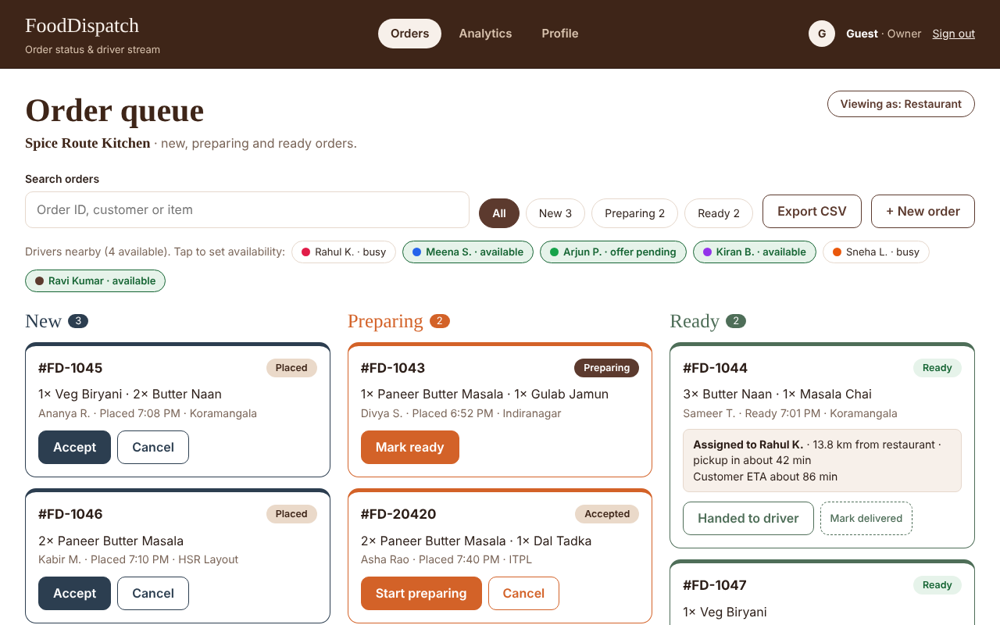
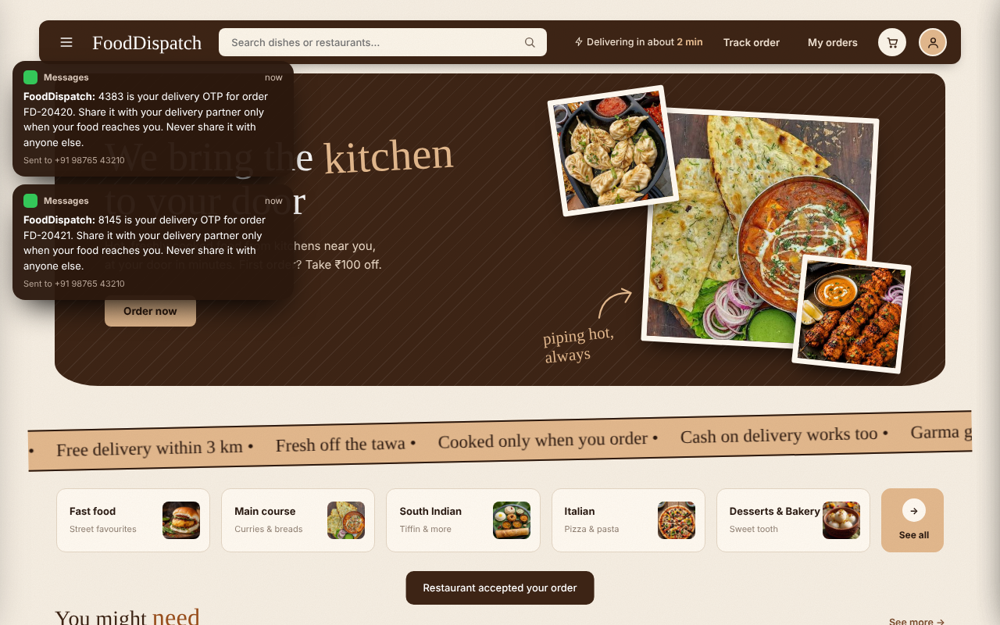
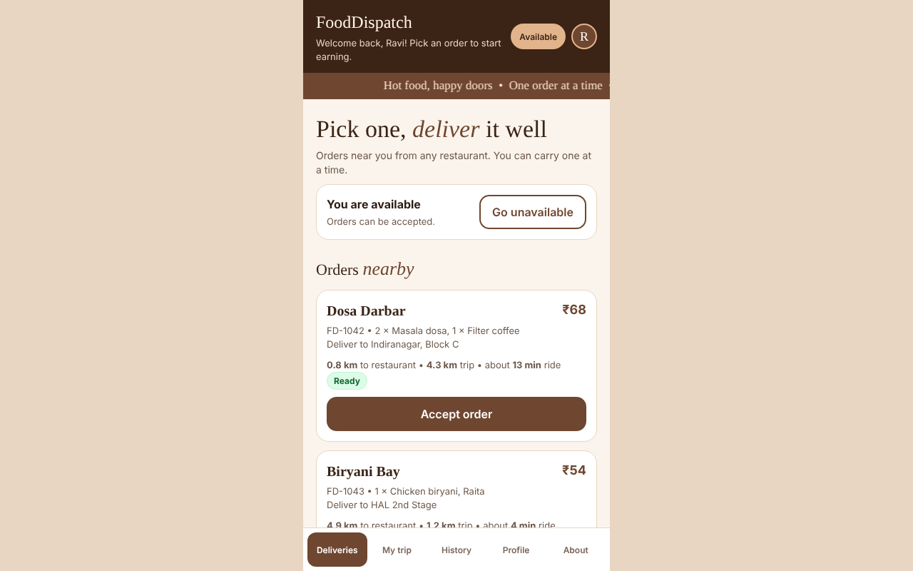

# FoodDispatch

Static demo apps (no build step). Open `index.html` in a browser or host on GitHub Pages.

| Page | HTML | CSS | JS |
|---|---|---|---|
| Landing | index.html | css/landing.css | js/landing.js, js/landing-images.js |
| Customer | customer.html | css/customer.css | js/customer.js, js/customer-images.js |
| Driver | driver.html | css/driver.css | js/driver.js |
| Restaurant | restaurant.html | css/restaurant.css | js/restaurant.js |

`js/session.js` is shared by all pages: it holds the logged-in user so each page can fill its profile.
`*-images.js` hold the embedded base64 images and must load before the matching main script.

**Login (demo):** logging in or signing up on `index.html` opens the page for the chosen role and fills that page's profile
(name, email). There is no backend, so accounts are not verified; data stays in the browser.

**Security:** Google Maps keys now live only in `js/config.js`. A browser key is public by nature, so restrict it
(HTTP referrer + API limits) in Google Cloud Console and rotate any key that was shared earlier. Steps are in that file.

## How the three pages work together

All three pages share ONE localStorage key, `fooddispatch_orders`, through `js/store.js` (`FDStore`).
Serve the folder over http (GitHub Pages or `python3 -m http.server`) and open the pages in tabs of the same browser.
`file://` pages may not share storage in every browser.

```
Customer places order -> Placed
Restaurant: Accept -> Preparing -> Ready      (Ready offers the order to the NEAREST free driver)
Driver (or restaurant hand-over): Picked up
Driver, with the customer's OTP: Delivered
```

- **Status rules** are enforced in one place (`FDStore.advance`): Placed -> Accepted -> Preparing -> Ready -> Picked up -> Delivered, one step at a time, and only the right role can take each step. Customers can cancel only while Placed or Accepted.
- **Dispatch:** when the restaurant marks an order Ready it is offered to the nearest available driver (simulated drivers D1-D5, plus the person on the driver page while that page is open). The driver page shows the offer with Accept / Decline.
- **Pickup needs two confirmations:** the driver confirms pickup on the driver page AND the restaurant presses Handed to driver. Until both are done the order stays Ready and the driver stays at the restaurant on every page. Simulated drivers confirm automatically when they arrive.
- **Live driver first:** while someone is logged in on the driver page, offers go to them; the simulated drivers pause (button on the restaurant page brings them back).
- **Automatic connection:** the restaurant page has a **Follow new orders** checkbox (on by default). When its kitchen has nothing open and a customer orders from another kitchen, the page switches to that kitchen by itself. If the kitchen is busy it is not switched away; a notice shows where the other orders are waiting. If no restaurant page is open in the same browser when a customer orders, the customer page says so.
- **Driver opens the page late:** if the driver page is closed when an order turns Ready, a simulated driver takes it. The moment the real driver opens the driver page (and is Available), every Ready order that nobody has collected yet is offered to them instead; orders whose pickup is already under way are left alone. The restaurant tab must be open, because it does the dispatching.
- **Stuck "busy" driver:** the restaurant's driver chips say why a live driver is not available ("busy, on a delivery" or "set to unavailable by the driver"). If the shared order a trip belonged to no longer exists (site data cleared, reset), both the restaurant and driver pages forget that trip after about 5 seconds, so the driver goes back to available.
- **Driver cancel:** before pickup a driver can give an order back (tap Cancel twice). It stays Ready and is offered to another driver, never back to the same one.
- **Contact:** customer to restaurant, driver to restaurant, restaurant to customer and driver. Phone links come from each profile; messages are kept on the order. Simulated drivers reply automatically.
- **One route per order:** the restaurant (simulated drivers) or the driver page (live driver) draws the pickup route, the restaurant draws the delivery route, and the customer, restaurant and driver maps all use those same routes.
- **Maps never stay blank:** on the restaurant, driver and customer pages, if Google Maps can't load (key blocked or restricted, API not enabled, offline) it switches to OpenStreetMap and says why. Fix the key in `js/config.js` to get Google back.
- **One clock:** the restaurant's speed setting (x10 / real speed) is shared with the driver and customer pages, so ETAs, countdowns and driver movement run at the same pace everywhere.
- **Live tracking:** the assigned driver's position and ETA are written onto the order and shown on the customer's tracking page.
- **Persistence:** customer orders and status history are rebuilt from storage after a refresh.
- **Restaurant queue** shows orders for ONE kitchen at a time. Customers can order from any of the 11 restaurants, so the restaurant page has a **Kitchen** switcher under the title: it lists every restaurant with its open-order count, and a notice appears whenever orders are waiting at a different kitchen (one click switches to it). The default is Spice Route Kitchen. The choice is saved in the profile, and the map and simulated drivers move to the chosen kitchen.
- **Export CSV** (restaurant) downloads exactly the rows currently visible: the status filter and search both apply.
- The simulated drivers move while the **restaurant tab is open** (that tab runs the dispatch simulation). Keep it open during a demo.
- To wipe the demo data: clear site data, or run `localStorage.removeItem('fooddispatch_orders')` in the console.

## Tests

- `tests/store-tests.html`: open in a browser, checks the status rules (24 tests).
- `TESTING.md`: manual test cases for the whole journey and usability notes.
- `tests/e2e-map-fallback.js`: checks the restaurant map falls back to OpenStreetMap when Google fails.
- `tests/e2e-playwright.js`: optional automated run of the full journey (66 checks, needs Playwright).
- `tests/e2e-map-failures.js`: Google refused or blocked -> restaurant, driver and customer pages all fall back to OpenStreetMap.
- `tests/e2e-kitchens.py`: orders from all 11 restaurants reach the restaurant page through the Kitchen switcher, then a full Napoli Pizzeria order is delivered (Python Playwright, `python3 tests/e2e-kitchens.py`, server on port 8765).
- `tests/e2e-auto-connect.py`: customer order reaches the restaurant page and then the driver page with no clicking, including the follow rules and the "no restaurant page open" warning.
- `tests/e2e-driver-busy.py`: busy/unavailable labels, stale trips cleared, and a real trip survives a driver-page reload.
- `tests/e2e-late-driver.py`: driver page opened after the order is Ready still receives and can accept it.
- `tests/e2e-dispatch.js`: demo orders are never offered to the live driver, and a live driver's offer lasts ~2 real minutes.

## Screenshots

Captured in a sandbox with no internet, so maps and web fonts are missing. Retake them on your machine before submission.

| Restaurant queue | Customer order tracking | Driver orders |
|---|---|---|
|  |  |  |

## Tech stack note

The PRD lists Bootstrap 5. The pages use their own CSS; see `docs/PRD-change-request.md`.
